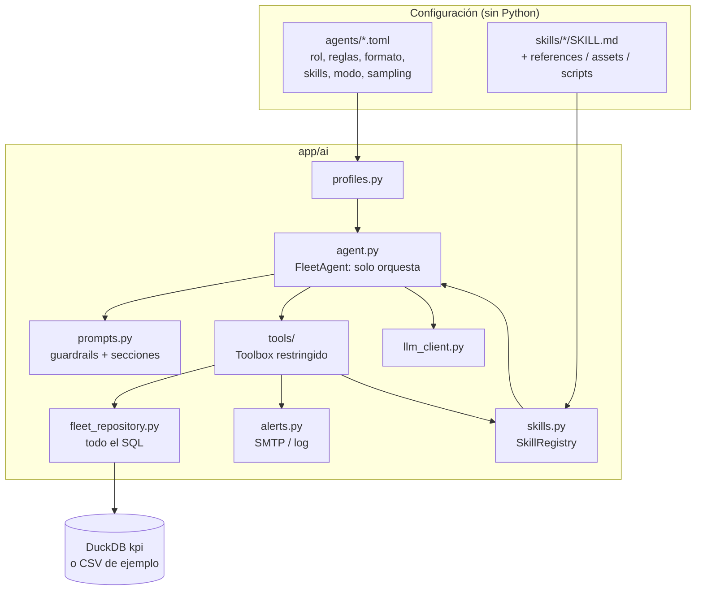

# Nota técnica: refactorización del agente con skills propias

**Actividad:** Refactorización y Personalización de un Sistema Agéntico mediante Skills Propias
(AI For Devs Jr. 3, Módulo 2, KODIGO Academy)
**Autor:** Wilmer Henrry Salazar Martínez
**Proyecto base:** MDK Mining AI (este repositorio), capa `app/ai/`
**Rama:** `refactor/agent-skills`

---

## 1. Punto de partida

El proyecto ya tenía un asistente LLM (`FleetAgent`) que responde preguntas sobre
una flota de mineros de Bitcoin a partir de KPIs precalculados por la capa de ML.
Funcionaba, pero la capa de IA eran dos archivos con casi todo mezclado:

| Problema | Evidencia en el código original |
|---|---|
| `tools.py` monolítico (342 líneas) | Un solo módulo con los esquemas JSON de las tools, el SQL sobre DuckDB, la regla de negocio de `recommend_action`, el envío SMTP y el registro/dispatch |
| Esquema y función separados | `TOOL_SCHEMAS` (lista) y `TOOL_REGISTRY` (dict) se mantenían a mano en paralelo; agregar una tool exigía tocar tres lugares |
| Comportamiento fijo en código | `SYSTEM_PROMPT_BASE` era una constante: una sola personalidad, sin forma de tener otro agente sin copiar la clase |
| Umbrales incrustados | `> 80`, `> 50`, `> 30`, `>= 1.0` escritos dentro del SQL y de la regla, fuera de `config.py` |
| Lógica duplicada | `ask()` y `ask_with_tools()` armaban los mensajes cada uno por su cuenta; `_kpi_table_exists()` se repetía al inicio de cada tool |
| Errores silenciados | `except Exception: return False` al comprobar la tabla; cualquier fallo de DuckDB se leía como "tabla vacía" |
| Difícil de probar | Las tools abrían `settings.DUCKDB_PATH` directamente: sin base de datos generada no había forma de ejecutarlas. La capa de IA tenía 0 pruebas |

## 2. Arquitectura resultante



| Módulo | Única responsabilidad |
|---|---|
| `agent.py` | Ciclo prompt → LLM → tool calls → respuesta. No sabe SQL, ni SMTP, ni textos de prompt |
| `profiles.py` | Cargar y validar `agents/<nombre>.toml` (claves desconocidas son error) |
| `skills.py` | Descubrir skills, validar el frontmatter, leer instrucciones y recursos bajo demanda |
| `prompts.py` | Componer el system prompt por secciones; contiene los guardrails fijos |
| `fleet_repository.py` | Todas las consultas a `kpi`; devuelve registros planos y lanza `KpiUnavailableError` |
| `alerts.py` | Entrega de alertas (SMTP o archivo local) y su configuración |
| `tools/base.py` | `Tool` (esquema + handler juntos) y `Toolbox` (restringir, despachar, errores como JSON) |
| `tools/fleet.py`, `actions.py`, `alerts.py`, `skill_tools.py` | Adaptadores delgados entre el LLM y cada dependencia |
| `cli.py` | Inspeccionar agentes, skills, prompts y tools desde la terminal |

Las dependencias se inyectan (`FleetAgent(client, profile, repository, skills, alert_sender)`),
por eso las pruebas usan un repositorio en memoria cargado desde un CSV y un LLM guionado.

## 3. Skills propias

Cada skill es una carpeta `skills/<nombre>/` con un `SKILL.md` (frontmatter
`name`, `description`, `allowed-tools`, `metadata` + instrucciones en markdown)
y recursos opcionales, siguiendo el formato de Agent Skills.

| Skill | Qué encapsula | `allowed-tools` | Recursos |
|---|---|---|---|
| `fleet-triage` | Convertir la lista de mineros en riesgo en una cola P1/P2 | `get_fleet_summary`, `list_miners_at_risk` | `references/severity-matrix.md`, `scripts/rank_severity.py` |
| `miner-diagnosis` | Diagnóstico de un minero: lectura → modo de falla probable → acción | `get_device_status`, `recommend_action` | `references/failure-modes.md` |
| `profitability-analysis` | Interpretar TE / ETE / PD como decisión mantener / ajustar / apagar | `get_fleet_summary`, `list_unprofitable_miners`, `get_device_status` | `references/kpi-glossary.md` |
| `operator-alert` | Cuándo y cómo enviar una alerta al operador | `get_device_status`, `recommend_action`, `send_operator_alert` | `assets/alert-template.md` |

Criterios de diseño:

- **La descripción dice qué hace y cuándo usarla** ("Use when…"). Es lo único que
  el modelo ve en modo `on_demand`, así que de ella depende que elija bien.
- **Procedimiento numerado + reglas**, incluyendo qué hacer cuando la tool
  devuelve error o la lista viene vacía.
- **Los umbrales que aplican las tools se nombran, no se copian.** Las skills
  hablan de `temp_warning_c` o `ete_breakeven` y el prompt incluye una sección
  "Active thresholds" generada desde `config.py`, así que cambiar un umbral no
  obliga a editar las skills. Las bandas propias de una skill (por ejemplo
  1.2x y 2x del break-even) sí viven en su referencia.
- **Divulgación progresiva.** Al descubrir solo se lee el frontmatter; el cuerpo
  y los recursos se leen cuando el agente los necesita.
- **El contenido sale del propio proyecto.** Las firmas de falla vienen de la
  física de `app/data/generator.py`; las fórmulas, de `app/pipeline/kpi.py`.
- **Recurso ejecutable.** `rank_severity.py` aplica la matriz de severidad de
  forma determinista (solo stdlib, JSON por stdin/stdout), así la priorización
  no depende de que el LLM compare números correctamente.

## 4. Personalización del agente

Un agente es un archivo TOML. Los tres perfiles incluidos cubren los tres modos
de integración de skills:

| Perfil | Skills | Activación | Tool calling | Precarga | Temp. |
|---|---|---|---|---|---|
| `copilot` | fleet-triage, profitability-analysis | `eager`: instrucciones y referencias dentro del prompt | no | resumen, en riesgo, no rentables | 0.2 |
| `maintenance` | fleet-triage, miner-diagnosis, operator-alert | `on_demand`: solo catálogo; el modelo llama `load_skill` | sí | en riesgo | 0.1 |
| `finance` | profitability-analysis | `eager`; las referencias se leen con `read_skill_resource` | sí | resumen, no rentables | 0.3 |

Cómo impactan las skills en el comportamiento (verificado en `tests/test_agent_skills.py`):

1. **Capacidades.** Las tools de un agente son la unión de los `allowed-tools`
   de sus skills. `finance` no tiene `send_operator_alert` ni `recommend_action`:
   no aparecen en su esquema y, si el modelo las pidiera igual, el `Toolbox`
   responde `not available to this agent`.
2. **Conocimiento.** El procedimiento de cada skill entra al contexto inyectado
   (`eager`) o cuando el modelo lo pide (`on_demand`).
3. **Prompt estructurado.** Secciones fijas en este orden: Role → Guardrails →
   Operating rules → Skills → Output format → Active thresholds → Fleet snapshot.
4. **Configuración alineada al rol.** `maintenance` usa temperatura 0.1 y más
   pasos (diagnósticos reproducibles, cadenas de tools más largas); `finance`
   exige una tabla y una línea de supuestos de mercado.

Para crear un agente nuevo basta un `agents/<nombre>.toml`; para darle una
capacidad nueva, una carpeta en `skills/`.

## 5. Decisiones de diseño y alternativas descartadas

| Decisión | Alternativa descartada | Por qué |
|---|---|---|
| Guardrails en código (`prompts.GUARDRAILS`) | Ponerlos en cada TOML | Son invariantes de seguridad ("no inventar KPIs", "el Decision Engine decide"). Si vivieran en el perfil, un perfil mal escrito podría omitirlos |
| `copilot` sin tool calling | Tool calling para todos | El endpoint por defecto (Gemma en NVIDIA NIM) no soporta `tool_choice="auto"` (ver `TROUBLESHOOTING.md`). El agente del dashboard debe seguir funcionando con ese modelo |
| Sin tool calling las referencias se inyectan; con tool calling solo se listan | Inyectar siempre todo | Si el modelo no puede pedir un archivo hay que dárselo; si puede, se ahorra contexto |
| Parser propio de frontmatter (~30 líneas) | Añadir PyYAML | El formato solo necesita `clave: valor` y un nivel anidado. Lo que no entiende lo rechaza con error en vez de interpretarlo mal |
| Perfiles en TOML | YAML o JSON | `tomllib` es stdlib, admite comentarios y cadenas multilínea |
| `skills/` en la raíz del repo | Dentro de `app/ai/` | Son contenido editable por alguien que no programa; no son código del paquete |
| Las tools reciben sus dependencias por parámetro | Singletons de módulo como antes | Permite probar con un CSV en memoria y sin SMTP |
| Scripts de skills en subproceso aislado (`python -I`, timeout 10 s, solo `scripts/*.py` de skills del perfil) | Importarlos dentro del proceso | Un script de skill no debe poder tocar el estado del agente; las rutas se validan contra path traversal |
| Mantener un único `ask()` | Conservar `ask()` + `ask_with_tools()` | Con cero tools el ciclo termina en la primera respuesta: el caso "sin tools" es el mismo código |
| No usar LangChain / frameworks de agentes | — | Coherente con la decisión original del proyecto (`technical_report.md` §"Why not langchain") |

## 6. Cambios de comportamiento respecto al original

La refactorización no es 100 % neutra; estos son los cambios observables:

- `FleetAgent.ask_with_tools()` ya no existe. `ask()` hace tool calling si el perfil lo activa.
- `FleetAgent()` sin argumentos sigue funcionando (perfil `copilot`), pero su
  prompt ahora incluye las skills y un tercer bloque precargado (mineros no rentables).
- Tool nueva `list_unprofitable_miners`, y tres meta-tools de skills
  (`load_skill`, `read_skill_resource`, `run_skill_script`).
- `list_miners_at_risk` desempata por temperatura cuando los errores promedio son iguales.
- Los umbrales `RISK_TEMP_C`, `RISK_AVG_ERRORS`, `ACTION_ERROR_COUNT`, `ETE_BREAKEVEN`
  están en `config.py` (mismos valores que antes) y se pueden cambiar por variable de entorno.
- Base de datos ausente → `KpiUnavailableError` con mensaje claro, en lugar de tratar
  cualquier excepción como "tabla vacía".
- El envío SMTP captura `SMTPException` / `OSError`, no `Exception`.
- `recommend_action` trata el break-even como no rentable (`>=`, igual que el
  resto del sistema) y su motivo pasó de `unprofitable_ete_gt_1` a
  `unprofitable_ete_at_or_above_breakeven`, porque el umbral es configurable.
- El dashboard tiene un selector de agente en la pestaña AI Assistant.
- `docs/technical_report.md` y `technical_report_condensed.md` describen el
  estado previo a esta refactorización (son los informes entregados en su
  momento). Solo se les agregó un aviso inicial que remite a esta nota.

## 7. Verificación

```bash
pip install -r requirements.txt
pytest tests/test_agent_skills.py -q        # 53 pruebas de la capa de agentes
python -m app.ai.cli --list-agents
python -m app.ai.cli --list-skills
python -m app.ai.cli --agent maintenance --show-prompt --demo
python -m app.ai.cli --agent finance --call-tool send_operator_alert --demo        # debe rechazarla
python -m app.ai.cli --agent maintenance --call-tool recommend_action --args device_id=miner_007 --demo
python skills/fleet-triage/scripts/rank_severity.py examples/severity_payload.json
```

Lo que cubren las pruebas: formato y validez de las 4 skills, confinamiento de
rutas de recursos, validación de perfiles, consultas del repositorio contra
`examples/kpi_sample.csv`, regla de `recommend_action`, tools por perfil, los
tres modos de prompt, el ciclo del agente (carga de skill bajo demanda, alerta
al log local, ejecución del script, límite de pasos), el script de severidad
y los errores de uso del CLI. Los comandos funcionan igual en PowerShell, cmd y
bash: `--args` acepta `clave=valor` y el script recibe la ruta del archivo.

`examples/prompts/` guarda el prompt real que recibe cada agente sobre los datos
de ejemplo, para ver la personalización sin instalar nada.

**Limitaciones conocidas**

- El ciclo del agente se probó con un LLM guionado (`ScriptedLLM`), no contra un
  modelo real: en el entorno de desarrollo no había `NVIDIA_API_KEY`. Falta
  comprobar con un modelo real que elige la skill correcta para las preguntas de
  `examples/questions.md`.
- `maintenance` y `finance` requieren un `LLM_MODEL` con tool calling.
- El selector del dashboard se verificó por compilación, no ejecutando Streamlit.

## 8. Uso de IA como herramienta de apoyo

**Herramienta:** Claude Code (Anthropic), en una sesión sobre este repositorio.

**Qué hizo la IA**

- Revisó mis repositorios de GitHub y propuso este proyecto como base por tener
  ya un agente con tools y un `tools.py` monolítico.
- Hizo el diagnóstico de la sección 1 leyendo `agent.py`, `tools.py`, `llm_client.py` y `config.py`.
- Escribió la refactorización, las cuatro skills, los tres perfiles, las pruebas y el borrador de esta nota.
- Ejecutó el pipeline (`run_all --fleet-size 8 --days 1 --skip-training`) para generar
  los datos de ejemplo, y corrió `pytest` y `ruff` sobre el resultado.

**Qué se validó y cómo**

| Afirmación | Evidencia |
|---|---|
| No se rompió lo existente | Las pruebas previas que no dependen de `torch` ni `scikit-learn` siguen pasando; las de `test_models.py` requieren esas librerías, que no se instalaron en el entorno de trabajo |
| Las skills cambian el comportamiento | `TestPersonalization` y `TestAgentLoop` |
| El contenido de las skills corresponde al proyecto | Firmas de falla contrastadas con `generator.py`; fórmulas con `kpi.py`; valores nominales con `asic_specs.py` |
| La restricción de Gemma con tool calling es real | Ya estaba documentada en `docs/TROUBLESHOOTING.md` antes de la refactorización |

**Revisión y decisiones propias**

Las decisiones que tomé yo y que condicionaron el trabajo de la IA:

- **Proyecto base.** Decidí refactorizar un proyecto propio de mi GitHub en lugar
  de una guía de semanas anteriores. La IA propuso cuál entre los candidatos en
  Python con LLM; acepté este porque ya tenía un agente con tools en uso real.
- **Sin Docker.** Descarté contenerizar la entrega: el proyecto completo arrastra
  `torch`, `xgboost` y `stable-baselines3`, y una imagen así no aporta nada a una
  actividad que evalúa la capa de agentes. Por eso la capa se puede ejecutar sola
  con `--demo` y un CSV de 160 KB, sin pipeline de ML ni base de datos generada.
- **Forma de validar.** Exigí que cada cambio quedara respaldado por pruebas
  automáticas y comandos reproducibles (sección 7), en vez de aceptar la
  explicación de la IA: 53 pruebas cubren las skills, los perfiles, las tools,
  el ciclo del agente y el CLI, y las limitaciones quedan declaradas por escrito.
- **Segunda revisión.** No di por buena la primera versión. Pedí una revisión
  completa e independiente del resultado antes de entregar; lo que encontró y
  cómo se corrigió está en la tabla siguiente.

**Qué estaba mal en la primera versión generada y cómo se corrigió**

| Hallazgo de la revisión | Corrección |
|---|---|
| La matriz de severidad definía P3, pero `list_miners_at_risk` solo devuelve mineros que ya cumplen P2: P3 era inalcanzable | Matriz, skill y script quedaron en P1/P2, con la advertencia de que los promedios ocultan picos |
| Los datos de ejemplo (8 mineros, 1 día) no contenían ninguna falla: el generador inyecta `int(8 x 0.05) = 0` y las fallas empiezan el día 10 | Muestra regenerada de una corrida de 30 días con fallas; consulta de exportación en `examples/export_sample.sql`; una prueba fija el caso de `miner_007` |
| La referencia de KPIs afirmaba que un TE de 2 a 4 veces el nominal es normal; en overclock es bastante mayor | Reescrita: explica por qué varía y pide comparar entre mineros del mismo modelo y modo |
| La plantilla de alerta venía firmada por "MDK Copilot", el agente que no puede enviar alertas | Firma corregida al agente de mantenimiento |
| `operator-alert` exigía la acción recomendada sin tener `recommend_action` entre sus tools | Agregada a `allowed-tools`; el procedimiento dice de dónde sale cada campo |
| La skill de triage decía "si puedes ejecutar scripts" sin nombrar la tool | El procedimiento da la llamada exacta a `run_skill_script` |
| `recommend_action` usaba `>` para el break-even y el resto del sistema `>=`; los umbrales por defecto se congelaban al importar | Unificado a `>=`; los umbrales se leen de la configuración en cada llamada |
| El CLI mostraba un traceback sin API key o con `--args` inválido, y el comando documentado con `<` falla en PowerShell | Errores con mensaje y código 2; `--args clave=valor`; el script acepta la ruta del archivo |
| El README y el diagrama de arquitectura seguían describiendo 5 tools y el flujo anterior | Actualizados; los informes históricos llevan un aviso que remite a esta nota |
